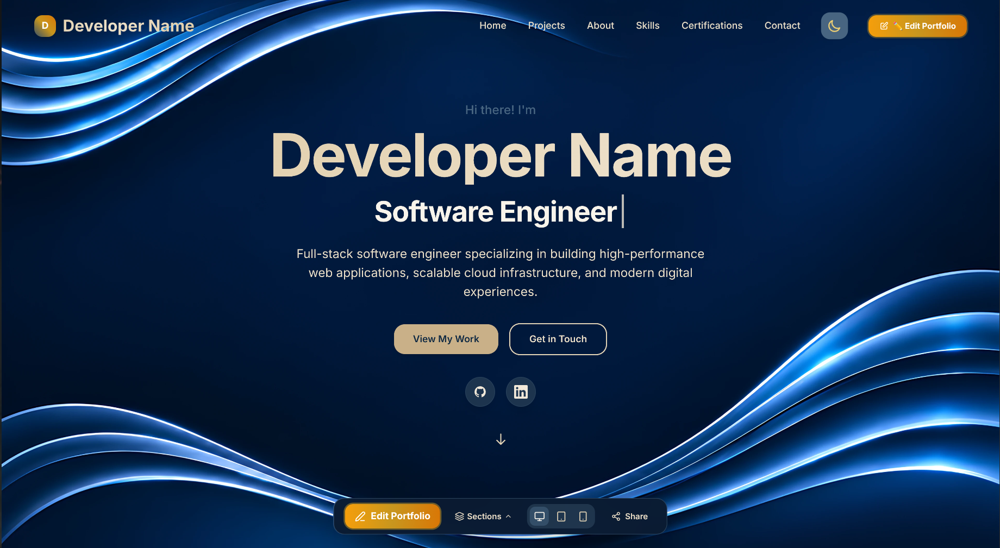
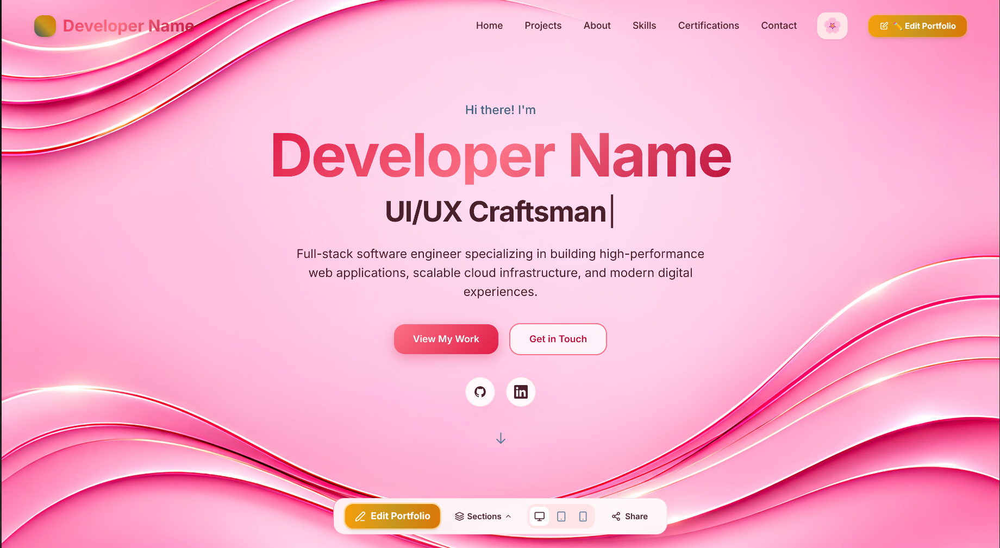
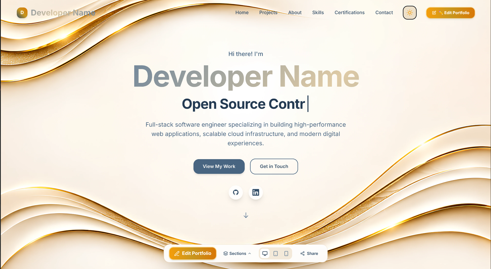
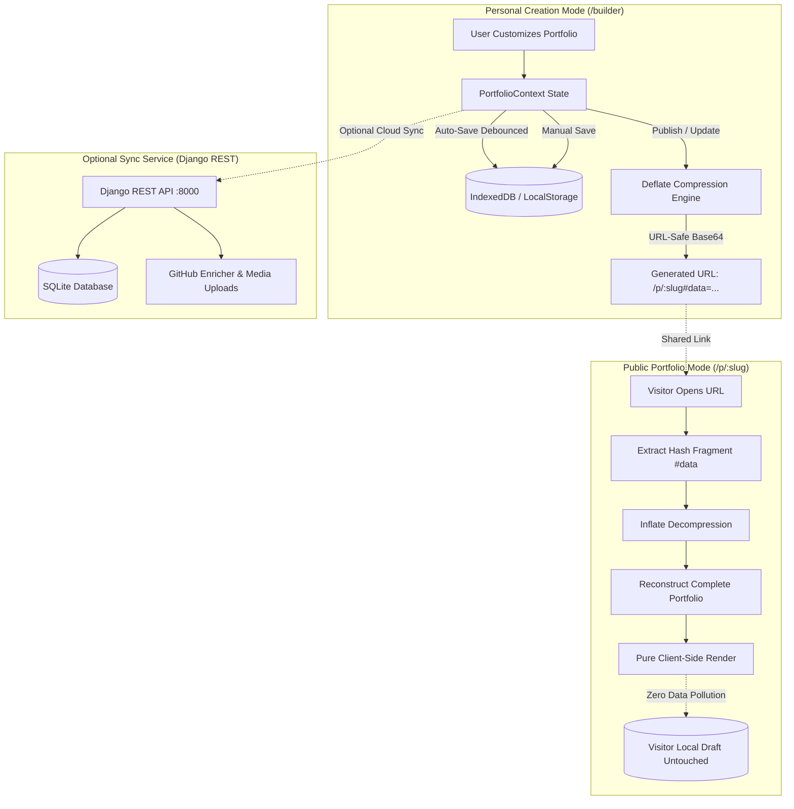

<div align="center">

# StandOut - Build Your Digital Presence. Make It Yours.

[](https://react.dev/)
[](https://vitejs.dev/)
[](https://tailwindcss.com/)
[](https://www.djangoproject.com/)
[](https://www.django-rest-framework.org/)
[](https://developer.mozilla.org/en-US/docs/Web/API/IndexedDB_API)
[](LICENSE)

<p align="center">
  <strong>StandOut - Build Your Digital Presence. Make It Yours.</strong><br>
  Craft a bespoke digital showcase, customize themes, curate projects, skills, and credentials, and publish zero-server, permanent shareable URLs encoded directly into compressed browser payloads.
</p>

[Explore Features](#-key-features) • [Architecture](#-architecture--data-flow) • [Quickstart](#-quickstart--installation) • [Dual Mode System](#-dual-mode-system) • [API Guide](#-api-endpoints)

---

<p align="center">
  
</p>
<p align="center">
  
  
</p>

---

</div>

## Overview

**StandOut** transforms portfolio creation from static boilerplate into a rich, living web experience. Built with **React 18**, **Tailwind CSS**, and **Django REST Framework**, it pairs a full-featured visual studio editor with an innovative **client-side compression engine** that enables self-contained, permanent portfolio sharing with zero mandatory cloud databases.

Whether showcasing full-stack engineering, machine learning research, or cybersecurity credentials, **StandOut** gives creators complete control over their digital narrative.

---

## Key Features

### Visual Customization Studio (`/builder`)
- **Real-Time Live Editing**: Update copy, achievements, typography, and section arrangements with zero latency.
- **Multi-Device Responsive Canvas**: Toggle on-the-fly between Desktop, Tablet, and Mobile device preview viewports.
- **Section Visibility & Toggle Control**: Show or hide entire sections (Projects, Skills, Certifications, Contact, Custom Pages) with a single click.
- **Floating Toast System**: Non-blocking toast notifications with zero layout shift or document reflow.

### Dual-Tier Persistent Local Storage
- **High-Capacity IndexedDB**: Implements an asynchronous `StandOutDB` client backed by `localStorage` fallback, bypassing standard 5MB storage quotas.
- **Infinite Lifecycle**: Work persists seamlessly across browser reloads, accidental tab closures, and device restarts.
- **Safe Mode Isolation**: Opening someone else's shared portfolio will never overwrite or pollute your local drafting state.

### Zero-Dependency Portable Shareable URLs (`/p/:slug#data=...`)
- **Deflate Compression Pipeline**: Serializes the full portfolio state using `pako` Deflate compression into a URL-safe Base64 hash fragment.
- **Self-Contained & Serverless**: Links reconstruct the exact customized site on any remote device, incognito browser, or webview without network database dependencies.
- **Permanent Vanity Slugs**: Updating your published site retains your stable base URL slug (`/p/:slug`), preserving your personalized brand identity across iterations.

### 3D Runway Carousel & Interactive Project Lab
- **Perspective Staging**: Interactive multi-card 3D depth carousel with smooth animations and touch/swipe gesture support.
- **Live Demo Viewport**: Embedded browser chrome with working address bar and interactive iframe demo preview.
- **Intelligent Asset & Stack Detection**: Automatically parses GitHub repositories to extract README screenshots, live deployment URLs, and verified technology badges.

### Dynamic Skills Matrix with Conflict Detection
- **Visual Category Builder**: Organize technologies into categorized cards with curated inline SVG brand vectors.
- **Duplicate Detection Guard**: Real-time cross-section and same-section duplicate detection prevents redundant skill entries and prompts intelligent reallocation.

### Certification Engine & LinkedIn Sync
- **Multi-Format Ingestion**: Import certifications via username search, direct LinkedIn URLs, or one-click CSV file parsing.
- **Dynamic SVG Badge Synthesis**: Procedurally generates official-looking vector credential badges with unique serial IDs and verification links.

### Floating Anti-Gravity Social Hub
- **Interactive Social Dock**: Physics-inspired floating badges for GitHub, LinkedIn, Discord, LeetCode, X/Twitter, and custom personal sites.
- **Custom Brand Uploads**: Upload bespoke brand logos or configure custom accent colors across all themes.

### Curated Luxury Aesthetics
- **Theme Switcher**: Fluid transitions between curated dark and light aesthetics.
- **Signature Palettes**:
  - 🌸 *Soft Pink Layered Waves* (Cherry blossom glassmorphism)
  - 🌊 *Midnight Navy Waves* (Deep cyber navy and electric blue)
  - 🪵 *Soft Cream Layered Waves* (Warm nude beige and slate)

---

## Architecture & Data Flow



---

## 📁 Project Structure

```text
StandOut/
├── backend/                        # Django REST Framework Backend
│   ├── api/                        # Core API Application
│   │   ├── models.py               # Portfolio, Project, Certificate, Contact models
│   │   ├── serializers.py          # DRF model serializers
│   │   ├── views.py                # REST endpoints and file upload handlers
│   │   └── urls.py                 # API URL routing
│   ├── portfolio_backend/          # Django project configuration
│   │   ├── settings.py             # App settings, CORS, and static/media config
│   │   └── urls.py                 # Root URL configuration
│   ├── manage.py                   # Django CLI utility
│   ├── requirements.txt            # Python dependencies
│   └── seed_data.py                # Initial database seed script
│
└── frontend/                       # Vite + React 18 SPA
    ├── public/                     # High-resolution SVG vectors, waves & assets
    ├── src/
    │   ├── components/             # Portfolio display components
    │   │   ├── Hero.jsx            # Dynamic Hero banner with avatar & waves
    │   │   ├── Projects.jsx        # 3D Project carousel & live preview frames
    │   │   ├── Skills.jsx          # Category grid & tech badges
    │   │   ├── Certifications.jsx  # Certificate deck, cards & verification
    │   │   ├── About.jsx           # Bio, achievements & education
    │   │   ├── Contact.jsx         # Contact form & anti-gravity floating links
    │   │   ├── Navbar.jsx          # Navigation, theme toggle & edit pill
    │   │   └── builder/            # Studio Builder tab panels
    │   │       ├── HomeTab.jsx     # Hero & identity settings
    │   │       ├── ProjectsTab.jsx # GitHub repo sync & project editor
    │   │       ├── SkillsTab.jsx   # Skills category builder & duplicate modal
    │   │       ├── CertificationsTab.jsx # Cert manager & CSV importer
    │   │       ├── ContactTab.jsx  # Social links & anti-gravity config
    │   │       ├── AppearanceTab.jsx # Color palettes, themes & typography
    │   │       └── PublishModal.jsx # Share link modal & slug management
    │   ├── contexts/
    │   │   ├── PortfolioContext.jsx # Core state machine & draft auto-saver
    │   │   └── ThemeContext.jsx    # Dark/Light theme manager
    │   ├── pages/
    │   │   ├── Builder.jsx         # Customization studio dashboard
    │   │   └── PortfolioView.jsx   # Client-rendered portfolio view
    │   ├── utils/
    │   │   ├── portfolioStorage.js # High-capacity IndexedDB storage engine
    │   │   ├── urlPortfolio.js     # Deflate compression & URL encoder
    │   │   └── certificateParser.js# CSV & text credential parser
    │   ├── services/
    │   │   └── api.js              # Axios HTTP client & GitHub fetcher
    │   ├── App.jsx                 # Client router configuration
    │   └── index.css               # Tailwind directives & glassmorphic utilities
    ├── tailwind.config.js          # Tailwind styling configuration
    └── package.json                # Frontend dependencies & scripts
```

---

## Quickstart & Installation

### Prerequisites
- **Node.js**: `v18.0.0` or later
- **Python**: `v3.9` or later
- **npm** or **yarn**

---

### 1. Frontend Setup

```bash
# Navigate to the frontend directory
cd frontend

# Install dependencies
npm install

# Start the Vite development server
npm run dev
```

The application will be accessible at:
👉 **`http://localhost:5173`**
- Studio Builder: `http://localhost:5173/builder`
- Default Portfolio: `http://localhost:5173/`

---

### 2. Backend Setup (Optional for cloud sync & uploads)

```bash
# Open a new terminal and navigate to backend
cd backend

# Create and activate a Python virtual environment
python3 -m venv venv
source venv/bin/activate       # On Windows: venv\Scripts\activate

# Install requirements
pip install -r requirements.txt

# Run database migrations
python manage.py migrate

# (Optional) Seed sample data
python manage.py shell < seed_data.py

# Launch the Django API server
python manage.py runserver 0.0.0.0:8000
```

The REST API will be accessible at:
👉 **`http://localhost:8000/api/`**
- Django Admin: `http://localhost:8000/admin/`

---

## Dual Mode System

| Capability | Personal Builder Mode (`/builder`) | Public Portfolio Mode (`/p/:slug#data=...`) |
| :--- | :--- | :--- |
| **Route** | `/builder` | `/p/:slug#data=...` |
| **Data Source** | IndexedDB (`StandOutDB`) | URL Hash Payload (`#data=...`) |
| **Editing & Controls** | Full WYSIWYG studio with tabs | Hidden (Pure portfolio viewing) |
| **Auto-Save** | Active (debounced sync to client storage) | Disabled (Visitor draft untouched) |
| **Persistence** | Persistent across browser sessions | Self-contained, immutable snapshot |
| **Network Reliance**| Zero (local first) | Zero (decompressed entirely in browser) |

---

## API Endpoints & Use Cases

| Method | Endpoint | Primary Use Case |
| :--- | :--- | :--- |
| `GET` | `/api/portfolios/` | **Profile Discovery**: Lists available portfolios for switching/managing creators. |
| `GET` | `/api/portfolios/{username}/` | **Portfolio Hydration**: Loads the full layout, themes, projects, and skills for `/:username`. |
| `PUT / POST` | `/api/portfolios/{username}/` | **Cloud Save & Sync**: Saves builder changes to the database as a permanent cloud backup. |
| `GET` | `/api/projects/` | **Showcase Feeds**: Powers the 3D project runway carousel and tech stack filters. |
| `POST` | `/api/contact/` | **Visitor Inquiries**: Stores messages sent through the interactive Contact form. |
| `POST` | `/api/upload/` | **Media Hosting**: Uploads custom profile avatars and background imagery (<10MB). |

---

## Privacy & Security

- **Client-Side Cryptographic URL Fragments**: Data embedded in `#data=...` fragments is parsed strictly on the client side. By standard RFC 3986 specification, URL fragments are **never sent to HTTP servers**, keeping your shared portfolio payload private from intermediate proxy logs.
- **Draft Isolation**: Public portfolio viewing runs in a sandboxed state that guarantees a visitor's local draft is never contaminated or overwritten by third-party links.

---

## 📄 License

This project is proprietary and confidential. **All Rights Reserved** to **Sonali Duvesh** ([@SonaliDuvesh](https://github.com/SonaliDuvesh)).

No individual or entity may copy, reproduce, modify, distribute, or use this software without the prior express written permission of the author. See [LICENSE](LICENSE) for full legal terms.

